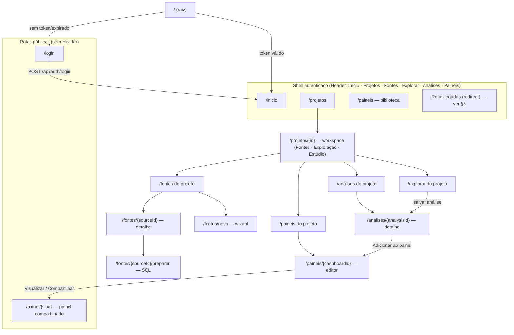
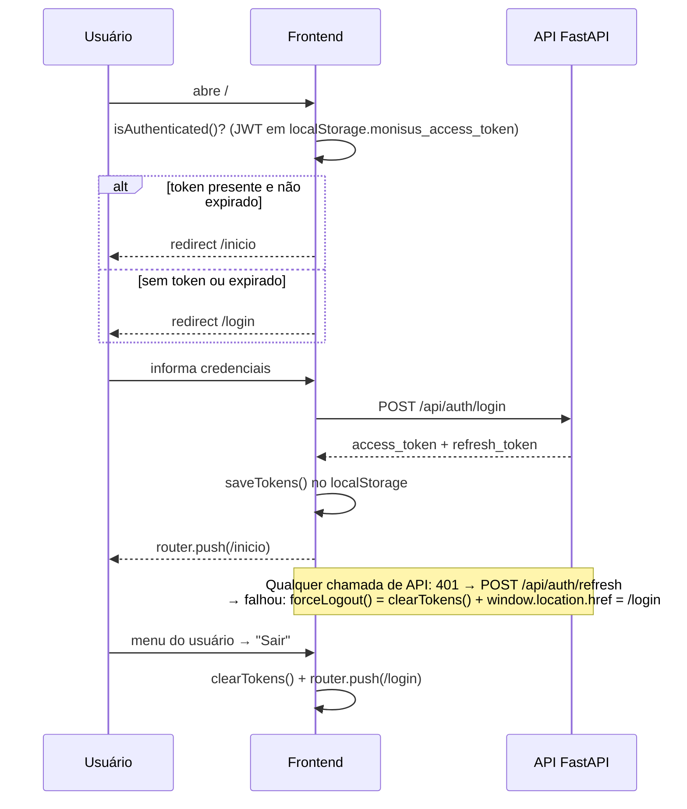
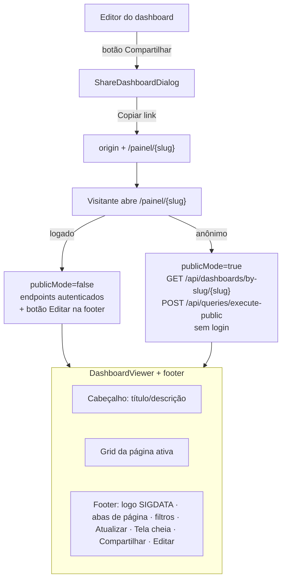

# Fluxo da aplicação SIGDATA — navegação do usuário

> **Objetivo:** descrição do fluxo de navegação da aplicação para validação.
> Baseado na inspeção do código-fonte (`frontend/` + `backend/`) em 15/10/2026.
> Cada afirmação aponta o arquivo-fonte correspondente (ver [Índice de fontes](#12-índice-de-fontes)).

---

## Sumário

1. [Visão geral da arquitetura de navegação](#1-visão-geral-da-arquitetura-de-navegação)
2. [Mapa global de rotas](#2-mapa-global-de-rotas)
3. [Entrada e autenticação](#3-entrada-e-autenticação)
4. [Início](#4-início)
5. [Projetos e fluxo de dados](#5-projetos-e-fluxo-de-dados)
6. [Painéis — biblioteca e editor](#6-painéis--biblioteca-e-editor)
7. [Compartilhar e visualização pública](#7-compartilhar-e-visualização-pública)
8. [Rotas legadas e redirects](#8-rotas-legadas-e-redirects)
9. [Navegação secundária por tela](#9-navegação-secundária-por-tela)
10. [Guardas de autenticação e permissões](#10-guardas-de-autenticação-e-permissões)
11. [Apêndice — problemas e pendências de navegação](#11-apêndice--problemas-e-pendências-de-navegação)
12. [Índice de fontes](#12-índice-de-fontes)

---

## 1. Visão geral da arquitetura de navegação

O frontend é um **Next.js 16 (App Router)** com dois grupos de rotas:

| Grupo | Caminho | Layout | Quem acessa |
|---|---|---|---|
| `(public)` | `app/(public)/…` | **Sem layout** (sem Header) | Qualquer um, sem login |
| `(authenticated)` | `app/(authenticated)/…` | `AppShell` = `Header` + `<main>` com rolagem própria | Usuário logado (guard via API, ver §10) |
| raiz | `app/page.tsx` | — | Redireciona para `/inicio` ou `/login` |

Pontos-chave:

- **A única navegação global renderizada é o `Header`** (`components/layout/header.tsx`). A `Sidebar` com a navegação de contexto do projeto existe no código (`components/layout/sidebar.tsx`) mas **não é importada por nenhum componente** — ver [problema P6](#problemas-ordenados).
- **Não existe `middleware.ts`** nem `layout` guard: o `AppShell` apenas monta a UI. A proteção real é o `forceLogout()` no client (`lib/api.ts`) e as rotas protegidas no backend.
- **Não há breadcrumbs.** O padrão de retorno é o link "← Voltar" no topo de cada página interna.
- O **painel compartilhado** (`/painel/[slug]`) fica fora do shell e funciona sem autenticação.

---

## 2. Mapa global de rotas

**Rotas (24 `page.tsx`):**

| URL | Arquivo | Resumo |
|---|---|---|
| `/` | `app/page.tsx` | Redirect → `/inicio` ou `/login` |
| `/login` | `app/(public)/login/page.tsx` | Login |
| `/painel/[slug]` | `app/(public)/painel/[slug]/page.tsx` | Painel compartilhado |
| `/inicio` | `app/(authenticated)/inicio/page.tsx` | Home com busca global e atalhos |
| `/projetos` | `…/projetos/page.tsx` | Lista de projetos |
| `/projetos/[projectId]` | `…/projetos/[projectId]/page.tsx` | **Workspace do projeto** (Fontes · Exploração · Estúdio) |
| `/projetos/[projectId]/fontes` | `…/fontes/page.tsx` | Fontes do projeto |
| `/projetos/[projectId]/fontes/nova` | `…/fontes/nova/page.tsx` | Wizard de nova fonte |
| `/projetos/[projectId]/fontes/[sourceId]` | `…/fontes/[sourceId]/page.tsx` | Detalhe da fonte |
| `/projetos/[projectId]/fontes/[sourceId]/preparar` | `…/preparar/page.tsx` | Workbench SQL → publicar dataset |
| `/projetos/[projectId]/explorar` | `…/explorar/page.tsx` | Bancada de exploração (Agente IA/SQL/Visual) |
| `/projetos/[projectId]/analises` | `…/analises/page.tsx` | Lista de análises |
| `/projetos/[projectId]/analises/[analysisId]` | `…/analises/[analysisId]/page.tsx` | Detalhe da análise |
| `/projetos/[projectId]/paineis` | `…/paineis/page.tsx` | Painéis do projeto |
| `/projetos/[projectId]/paineis/[dashboardId]` | `…/paineis/[dashboardId]/page.tsx` | **Editor do dashboard** |
| `/paineis` | `…/paineis/page.tsx` | Biblioteca global (tabs meus/compartilhados/recentes) |
| `/paineis/[id]` | `…/paineis/[id]/page.tsx` | Legado → redireciona para a rota do projeto |
| `/fontes`, `/fontes/nova`, `/fontes/[id]`, `/fontes/[id]/preparar` | `…/fontes/…` | Legados → redirect |
| `/analises`, `/analises/[id]` | `…/analises/…` | Legados → redirect |
| `/explorar` | `…/explorar/page.tsx` | Legado → redirect |

---

## 3. Entrada e autenticação

- Validação do token é **apenas cliente-side** (`lib/auth.ts#isAuthenticated` decodifica o `exp`).
- O logout automático (`forceLogout`) é um **hard navigation** para `/login` (`lib/api.ts`).
- Não há rota de "esqueci a senha" funcional — o texto no login não é um link ([problema P5](#problemas-ordenados)).

---

## 4. Início

`/inicio` (`app/(authenticated)/inicio/page.tsx`) é a home pós-login:

1. **Busca global** — busca dashboards, análises e datasets; cada resultado navega para:
   - painel → `/paineis/{id}`
   - análise → `/analises/{id}` (legado, redireciona)
   - dataset → `/explorar?datasetId={id}` ⚠ *deep-link se perde sem `projectId`* ([problema P3](#problemas-ordenados))
2. **Cards de atalho** — Painéis (`/paineis`), Análises (`/analises` ⚠ legado) e Conjuntos de dados (`/explorar` ⚠ legado) ([problemas P1/P2](#problemas-ordenados)).
3. **Projetos recentes** — card → `/projetos/{id}`.

---

## 5. Projetos e fluxo de dados

O projeto é a **unidade de contexto**: fontes, datasets, análises e painéis pertencem a um projeto.

```mermaid
flowchart LR
    A["Criar projeto<br/>/projetos"] --> B["Workspace + conectar fonte<br/>/projetos/{id}/fontes/nova"]
    B --> C["Detalhe da fonte<br/>(tabelas + datasets)"]
    C --> D["Preparar (SQL)<br/>…/fontes/{sid}/preparar"]
    D -->|"Publicar como Dataset"| E["Dataset"]
    E --> F["Workspace / Explorar<br/>Agente IA · SQL · Visual · Estúdio"]
    F -->|"Salvar análise"| G["Análise<br/>…/analises/{aid}"]
    G -->|"Adicionar ao painel"| H["Editor do dashboard<br/>…/paineis/{did}"]
    H -->|"Compartilhar"| I["Link público<br/>/painel/{slug}"]
```

Passos:

1. **`/projetos`** → criar (dialog) → **`/projetos/{id}`** — workspace em 3 painéis inspirado no NotebookLM:
   - **Esquerda — Fontes**: fontes do projeto (`listSources(projectId)`) com datasets publicados sob demanda + análises recentes; links para `/fontes` e `/analises`.
   - **Centro — Exploração**: abas Agente IA · SQL · Visual (motor `useExplorationEngine` compartilhado com `/explorar`); conversa persistente.
   - **Direita — Estúdio**: "Resultado atual" (draft da conversa/SQL) + itens fixados com estado próprio (apresentação isolada por item; fixados sobrevivem a novas mensagens/sessão). Botão "Fixar no Estúdio" copia o resultado atual.
   - Cabeçalho: nome/KPIs do projeto, ações (Fonte, Painel, Explorar) e links para Análises/Painéis. No mobile, fontes abrem em Sheet.
2. **Fontes** (`…/fontes`): lista → **Nova fonte** (wizard: tipo → formulário → testa conexão) → detalhe da fonte (tabelas por schema, datasets publicados).
3. **Preparar** (`…/fontes/{sid}/preparar`): browser de objetos + abas de SQL + resultado → **"Publicar como Dataset"**. Aceita `?table=schema__tabela` para abrir com uma tabela carregada.
4. **Explorar** (`…/explorar`): bancada em tela cheia com o mesmo núcleo do workspace (`useExplorationEngine` + `ExplorationCenter`); três modos — **Agente IA / SQL / Visual**; lê `?analysisId` e `?datasetId`; resultado pode virar **análise salva**; gráfico pode ir direto para o painel.
5. **Análises** (`…/analises`): lista → **Abrir** (detalhe com SQL + execução) ou **Editar** (volta ao `/explorar?analysisId=…`); **"Adicionar ao painel"** abre `AddToDashboardDialog` e navega para o editor.
6. **Painéis do projeto** (`…/paineis`): lista + "Novo dashboard" → editor.

---

## 6. Painéis — biblioteca e editor

### Biblioteca `/paineis`

- Tabs (estado local, não rota): **meus** (`createdBy === eu`) · **compartilhados** (demais) · **recentes** (ordena por `readRecentIds`).
- "Novo dashboard" → `CreateDashboardDialog` (com seletor de projeto) → navega para o editor.
- Card "Abrir" → `dashboardHref()` = `/projetos/{pid}/paineis/{id}` (ou `/paineis/{id}` sem projeto).

### Editor `/projetos/{pid}/paineis/{did}`

`DashboardDetail` carrega o dashboard (`getDashboard` + `recordRecentId`) → `DashboardBuilder`.

- **Modo edição** é estado local: "Editar" abre a **biblioteca lateral de gráficos** (arrastar-e-soltar); "Concluir edição" fecha.
- **Salvamento automático**: fila de `PUT /api/dashboards/{id}` (sem botão "Salvar"); erro exibe faixa "a próxima alteração reenvia".
- **Toolbar**: Atualizar dados · Informações (nome/descrição/tema/marca) · Largura (padrão 1280 / larga 1536 / tela cheia 100%) · **Compartilhar** · **Visualizar** (→ `/painel/{slug}`) · Editar/Concluir.
- **Filtros** do painel (card "Filtros" com `DashboardFiltersBar`) + `AddFilterDialog`.
- **Abas de página**: barra **fixa inferior** (`DashboardPageBar`) com renomear/mover/excluir/nova página; a página ativa é persistida no dashboard.
- **Voltar**: "← Painéis" → lista de painéis do projeto.

---

## 7. Compartilhar e visualização pública

- A página `/painel/[slug]` detecta `isAuthenticated()` apenas para decidir `publicMode` e `canEdit` — **não exige login para visualizar**.
- **Anônimo**: dados dos widgets vêm inline (`widget.analysisData`, payload do `by-slug`) + `execute-public`; `getDistinctValues` (autenticado) **nunca é chamado** → filtros usam inputs livres.
- **Footer** (`dashboard-footer.tsx`, no fluxo — nunca cobre o conteúdo):
  - logo oficial `Logo principal.svg` (respeita a aparência "Exibir marca SIGDATA");
  - abas de página (**troca local, não persiste** no servidor);
  - filtros interativos (inline em telas médias+, painel com ícone no mobile);
  - **Atualizar** (`refreshKey` remonta os widgets) · **Tela cheia** (Fullscreen API) · **Compartilhar** · **Editar** (só com sessão → `/paineis/{id}`).
- Estados da página: "Carregando painel…" / erro com "Tentar novamente" / "Painel não encontrado" → link para `/login`.
- **Copiloto (IA) está desativado no link público** (`enableCopilot={false}`).

---

## 8. Rotas legadas e redirects

| Rota legada | Mecanismo | Destino |
|---|---|---|
| `/paineis/[id]` | carrega o dashboard e `router.replace` | `/projetos/{pid}/paineis/{id}` (ou mantém se sem projeto) |
| `/analises/[id]` | `LegacyRedirect` (1 chamada API) | `/projetos/{pid}/analises/{id}` ou `/projetos` |
| `/fontes/[id]` | `LegacyRedirect` | `/projetos/{pid}/fontes/{id}` ou `/projetos` |
| `/fontes/[id]/preparar` | `LegacyRedirect` | ⚠ **perde o segmento `/preparar`** ([problema P4](#problemas-ordenados)) |
| `/fontes`, `/fontes/nova` | redirect server-side | `/projetos/{pid}/…` (via `?projectId`) ou `/projetos` |
| `/analises` | redirect server-side | `/projetos/{pid}/analises` (via `?project`) ou `/projetos` |
| `/explorar` | redirect server-side | `/projetos/{pid}/explorar` **só se houver `?projectId`**; senão `/projetos` (descarta `datasetId` — [problema P3](#problemas-ordenados)) |

---

## 9. Navegação secundária por tela

### Header (única nav global — `components/layout/header.tsx`)

| Item | Destino | Observação |
|---|---|---|
| Logo (BrandMark) | `/inicio` | |
| Projetos | `/projetos` | |
| Fontes | `/fontes` | ⚠ sem `?projectId` cai em `/projetos` ([P1](#problemas-ordenados)) |
| Explorar | `/explorar` | ⚠ idem |
| Análises | `/analises` | ⚠ idem |
| Painéis | `/paineis` | |
| Menu do usuário → Sair | `/login` | "Meu Perfil" e "Configurações" **não navegam** ([P5](#problemas-ordenados)) |

### Links "← Voltar" (padrão sem breadcrumbs)

| Tela | Destino |
|---|---|
| Editor do painel | `/projetos/{pid}/paineis` (ou `/paineis`) |
| Visão geral do projeto | `/projetos` |
| Detalhe da fonte | `/projetos/{pid}/fontes` |
| Nova fonte | `/projetos/{pid}/fontes` |
| Preparar (top bar ←) | `/projetos/{pid}/fontes/{sid}` |
| Detalhe da análise | `/projetos/{pid}/analises` |
| Explorar (←) | `/projetos/{pid}` |

### Tabs / abas (estado local — não são rotas)

- Biblioteca: `meus | compartilhados | recentes` (`paineis/page.tsx`).
- Explorar: `ai | sql | visual` (+ toggle mobile Conversa/Resultado).
- Preparar: abas de consulta.
- Painel (editor): abas de página na barra fixa inferior (persiste via PUT).
- Painel (visualizador): abas de página na **footer** (troca local, não persiste).

> **Nota:** `components/layout/sidebar.tsx` define a navegação de contexto do projeto (Visão geral, Fontes, Explorar, Análises, Painéis), mas **não é renderizada** em nenhum lugar — ver [P6](#problemas-ordenados).

---

## 10. Guardas de autenticação e permissões

| Camada | Existe? | Onde / comportamento |
|---|---|---|
| `middleware.ts` | **Não** | — |
| Guard no layout `(authenticated)` | **Não** | `AppShell` só monta Header + main |
| Redirect da raiz `/` | Sim (client) | `app/page.tsx` — `isAuthenticated()` |
| Guard por página | **Não** | nenhuma página checa token antes de renderizar |
| API client (guard efetivo) | Sim | `lib/api.ts`: 401 → `tryRefresh` → falhou → `forceLogout()` → `/login` |
| Endpoints públicos | Sim | `GET /api/dashboards/by-slug/{slug}` e `POST /api/queries/execute-public` (sem `get_current_token`) |
| Roles no backend | Sim | Criar painel: `ANALISTA\|ADMIN`; excluir painel: `ADMIN` |
| Roles no frontend | **Não** | `canEdit` do painel público = apenas `isAuthenticated()` ([P7](#problemas-ordenados)) |
| Escopo de projeto | Parcial | Rotas legadas usam o `projectId` só para redirecionar; quem decide acesso é o backend |

---

## 11. Apêndice — problemas e pendências de navegação

Lista gerada na inspeção, para validação/correção:

| # | Problema | Onde |
|---|---|---|
| **P1** | **Header: Fontes/Explorar/Análises sempre caem em `/projetos`** — apontam para rotas legadas que exigem `?projectId`; sem ele, redirecionam para a lista de projetos. 3 dos 5 itens do topo nunca chegam ao destino nomeado. | `frontend/components/layout/header.tsx:57,63,69` + redirects de `fontes/page.tsx`, `explorar/page.tsx`, `analises/page.tsx` |
| **P2** | Mesmo problema nos **atalhos do Início**: cards `href=/analises` (l.613), `href=/explorar` (l.622), atalho `createHref=/fontes` (l.627) e `actionHref=/explorar` (l.665). | `frontend/app/(authenticated)/inicio/page.tsx:613,618,622,627,665` |
| **P3** | **Deep-link de dataset perdido**: busca do Início gera `/explorar?datasetId={id}` (l.546), mas o redirect legado só repassa a query se houver `projectId` — caso contrário descarta o `datasetId`. | `frontend/app/(authenticated)/inicio/page.tsx:546` + `frontend/app/(authenticated)/explorar/page.tsx:24-29` |
| **P4** | **`/fontes/[id]/preparar` perde o segmento `/preparar`** no redirect (o `?table=…` chega ao detalhe da fonte sem efeito). Rota órfã (nenhum link interno aponta). | `frontend/components/shared/legacy-redirect.tsx:48-51` |
| **P5** | **Itens sem ação**: "Meu Perfil" e "Configurações" no menu do usuário (sem `href`/handler); "Esqueceu sua senha?" no login é texto puro. | `frontend/components/layout/header.tsx:111-118`, `frontend/app/(public)/login/page.tsx:74-76` |
| **P6** | **Sidebar não renderizada**: toda a navegação de contexto do projeto (Visão geral/Fontes/Explorar/Análises/Painéis) existe no código mas não é importada por nenhum componente (só `BrandMark` é exportado e usado pelo Header). | `frontend/components/layout/sidebar.tsx` |
| **P7** | **"Editar" no painel público para qualquer usuário logado**: `canEdit = isAuthenticated()` sem checagem de papel/proprietário — o erro só aparece ao abrir o editor. | `frontend/app/(public)/painel/[slug]/page.tsx:38-40,131` |
| **P8** | **Redirects em duas etapas** nas rotas legadas (1 chamada de API antes de navegar; em falha, "Tentar novamente"). Se o item não tiver projeto, o destino vira a lista genérica e o item se perde. | `frontend/components/shared/legacy-redirect.tsx:68-83` |
| **P9** | **Helpers mortos**: `projectPath()` e `analysisHref()` não são usados. | `frontend/lib/routes.ts:9-20` |

---

## 12. Índice de fontes

| Arquivo | Papel no fluxo |
|---|---|
| `frontend/app/page.tsx` | Redirect de entrada (`/` → `/inicio` ou `/login`) |
| `frontend/app/(public)/login/page.tsx` | Tela de login |
| `frontend/app/(public)/painel/[slug]/page.tsx` | Página do painel compartilhado (anônimo/logado) |
| `frontend/app/(authenticated)/layout.tsx` | `AppShell` (Header + main) do grupo autenticado |
| `frontend/app/(authenticated)/inicio/page.tsx` | Home com busca global e atalhos |
| `frontend/app/(authenticated)/projetos/**` | Projeto: workspace (Fontes · Exploração · Estúdio), fontes, preparar, explorar, análises, painéis |
| `frontend/app/(authenticated)/paineis/**` | Biblioteca global + rota legada do editor |
| `frontend/app/(authenticated)/{fontes,analises,explorar}/**` | Rotas legadas com redirects |
| `frontend/components/layout/header.tsx` | Única navegação global renderizada + logout |
| `frontend/components/layout/sidebar.tsx` | Sidebar de contexto (código órfão — não renderizada) |
| `frontend/components/layout/app-shell.tsx` | Shell: `h-dvh`, Header, `<main>` com rolagem |
| `frontend/lib/auth.ts` | `login`, `saveTokens`, `clearTokens`, `isAuthenticated` |
| `frontend/lib/api.ts` | Cliente HTTP: 401 → refresh → `forceLogout` |
| `frontend/lib/routes.ts` | `dashboardHref`, `legacyProjectId` (+ helpers mortos) |
| `frontend/lib/utils.ts` | `getDashboardSharePath` → `/painel/{slug}`; `dashboardWidthClass` |
| `frontend/lib/api/dashboards.ts` | `getDashboardBySlug` (endpoint público), parser `toDashboard` |
| `frontend/lib/api/queries.ts` | `executePublicQuery` (sem auth) |
| `frontend/components/dashboard/dashboard-builder.tsx` | Editor: toolbar, persistência (fila PUT), páginas |
| `frontend/components/dashboard/dashboard-page-bar.tsx` | Barra fixa inferior de abas (editor) |
| `frontend/components/dashboard/dashboard-detail.tsx` | Carrega dashboard → editor |
| `frontend/components/dashboard/share-dashboard-dialog.tsx` | Copia o link público |
| `frontend/components/dashboard/dashboard-viewer.tsx` | Visualizador (cabeçalho + grid + footer) |
| `frontend/components/dashboard/dashboard-footer.tsx` | Footer do painel compartilhado (logo, abas, filtros, ações) |
| `frontend/components/dashboard/dashboard-page-tabs.tsx` | Abas de página reutilizadas por editor e footer |
| `frontend/components/dashboard/dashboard-widget.tsx` | Consulta dos widgets (público × autenticado) |
| `backend/app/api/dashboards.py` | `GET /by-slug/{slug}` público + roles |
| `backend/app/api/queries.py` | `POST /execute-public` público |
